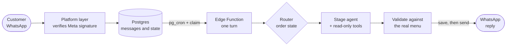

# WhatsApp AI Ordering Agent — Showcase

A multi-agent system that lets a restaurant customer place a complete order in a single WhatsApp conversation (products, delivery type, address, payment method) without staff typing it in by hand.

> **Production code is private because it runs live client systems. This repo documents the architecture and includes selected, sanitized excerpts. Happy to walk through the full codebase on a screen share.**

## Context

- **Problem:** restaurants take most orders over WhatsApp, and someone has to read each chat and copy the order into a system. That is slow and error-prone.
- **Who it is for:** small and mid-size restaurants in Colombia.
- **My role:** sole developer — architecture, code, integrations, deployment and maintenance.
- **Production figures (provided by the author):** used by about 15 restaurants, runs 24/7, saves about 2 hours a day of manual order handling.
- **Status, stated plainly:** the system was originally built as an n8n workflow. I am rebuilding it as code (TypeScript on Supabase Edge Functions); the migration is about 80% done. The excerpts in this repo come from the rewrite.
- Also part of the production system but **not** included in these excerpts: WhatsApp Flows with encrypted endpoints, and per-customer consent records under Colombian Law 1581.

## Demo

[VIDEO LINK] *(pending)*

You can also run a minimal, self-contained version of the core pattern locally — see [Run the demo](#run-the-demo).

## Architecture



1. **Platform layer:** verifies the Meta signature and stores every inbound message in Postgres.
2. **Turn handler:** a scheduler calls the Edge Function, which claims a turn (debounce + lease) and runs cheap deterministic filters (service off, ignored number, human takeover).
3. **Router:** picks the agent from the persisted order state. The model never chooses who answers.
4. **Stage agent:** intent, orchestrator, collector, one of several final-stage agents, or the closed-hours agent, each with only the tools its stage needs.
5. **Validation:** the parsed order is reconciled against the real menu; prices and totals come from code. The draft is saved before the reply is sent, and the turn is always closed.

## Key design decisions

**1. The code routes; the model does not.** Which agent answers the next message is a pure function of the persisted order state (no open order → orchestrator; missing fields → collector; complete → one of several final-stage agents chosen by delivery type, payment method, delivery fee and payment proof). Specialized agents each get a small prompt for their stage instead of one giant prompt that has to handle everything. The routing is unit-testable without a model. → `excerpts/01`

**2. Each agent gets only the tools its stage needs, and the first model round can force a tool.** Tools are declared once and allow-listed per agent. Order-building agents are forced to read the real menu in round one: without that, the model occasionally invented products from memory. A failing tool returns an error string to the model instead of crashing the turn, and the loop is bounded (after the maximum number of rounds it gets one last call with `tool_choice: "none"`). → `excerpts/02`

**3. The model is never trusted with facts that code or the database own.** One parser (the original workflow had four divergent copies) collects errors instead of throwing. The customer's phone comes from the WhatsApp message, not from the model's text. Prices and totals are recomputed from the real menu, products that are not on the menu are not saved, and a closed restaurant cannot start an order even if the model emits one. These guard rails do not depend on the prompt being obeyed. → `excerpts/03`, `excerpts/04`

**4. Debounce and exactly-once turns in Postgres, no Redis.** The n8n version used Redis for chat memory and buffering. In the rewrite, a "turn" is everything the customer wrote since the last reply, read together once they have been silent for a few seconds. Claiming is an atomic upsert on a lease, so two workers cannot take the same conversation. If a worker dies, the lease expires and the turn is retried; errors back off, and a message that fails repeatedly is abandoned so a poison message cannot burn model tokens forever. → `excerpts/05`

**5. Side effects are idempotent and saved before sending.** If the function dies between "saved" and "sent", the retry rewrites the same data instead of duplicating it, and an "already answered" check prevents a double reply. The service on/off gate is re-checked before every write and every send, because the owner can pause the bot mid-turn. → `excerpts/04`

**6. A small, safe serverless entrypoint.** The edge function is deployed without JWT, so it authenticates its caller with a secret that is compared inside the database (stored in a vault, never in code). It claims a bounded batch, returns HTTP 200 immediately, and processes the batch in the background in small concurrent groups. The turn is always closed, even on unexpected exceptions. Inbound Meta webhook signatures are verified in a separate shared platform layer, which is not part of these excerpts. → `excerpts/06`

Everything that touches the network or the database is injected (`Deps`), so the whole turn pipeline is tested with fakes.

## Stack

- **Language / runtime:** TypeScript on Supabase Edge Functions (Deno) for the production rewrite; Node.js 22 for the demo
- **LLM:** OpenAI Chat Completions with tool calling (direct API calls in production; the official SDK in the demo)
- **Data:** Supabase (Postgres, `pg_cron`, Vault) — replaces the Redis and Google Sheets used by the original n8n workflow
- **Messaging:** WhatsApp Cloud API
- **Deployment:** self-managed VPS plus Supabase
- **Original implementation:** n8n

## Repository structure

| Path | What it is |
|---|---|
| `excerpts/` | Real code from the private repo, trimmed and sanitized. Each file starts with what it shows and what was omitted. |
| `excerpts/01-stage-routing.ts` | Deterministic routing from order state to agent |
| `excerpts/02-tools-and-agent-loop.ts` | Tool definitions, per-agent allowlists, the bounded tool-calling loop |
| `excerpts/03-output-validation.ts` | Parsing and reconciling model output against the real menu |
| `excerpts/04-turn-pipeline.ts` | One conversational turn end to end, with guard rails and injected dependencies |
| `excerpts/05-turn-claiming.sql` | Debounce, atomic claiming with leases, bounded retries, internal-call secret |
| `excerpts/06-edge-entrypoint.ts` | The authenticated, fast-returning serverless entrypoint |
| `demo/` | A small, runnable CLI that reproduces the core pattern with fictional data and no external services |

The excerpts are for reading, not running: they import each other for illustration and some are not self-contained.

## Run the demo

The demo is a CLI conversation with the agent of a fictional burger shop. It uses the OpenAI SDK with tool calling, deterministic stage routing, code-validated order data and in-memory session state. No WhatsApp, Supabase or Redis. Requires Node.js 22+ and an OpenAI API key.

```bash
cd demo
npm install
cp .env.example .env     # then put your key in OPENAI_API_KEY
npm run demo
```

Try: `hi, I'd like 2 classic burgers and a lemonade` → give a name → `delivery` → an address → `cash` → `yes`. Type `/state` to see the saved order and `/reset` to start over. After each reply the CLI prints which agent answered and which tools it called.

What to look at: the agent changes stage as the order fills up (`orchestrator` → `collector` → `finalizer`); the total is always computed by code; asking for a product that is not on the menu is rejected by code, not by the prompt; the finalizer cannot confirm until the code says the order is complete.

Tests run without an API key (a scripted fake model, plus the real SDK against a local fake server):

```bash
cd demo && npm test
```

One simplification versus production: in the demo, order mutations are tools (`save_order_draft`, `confirm_order`) whose arguments are validated by code. In production they come back as tagged text that one parser validates (a legacy of the n8n prompts; a move to structured JSON output is planned).

## License

All rights reserved. See [LICENSE](LICENSE).
